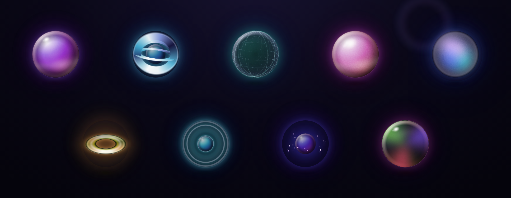
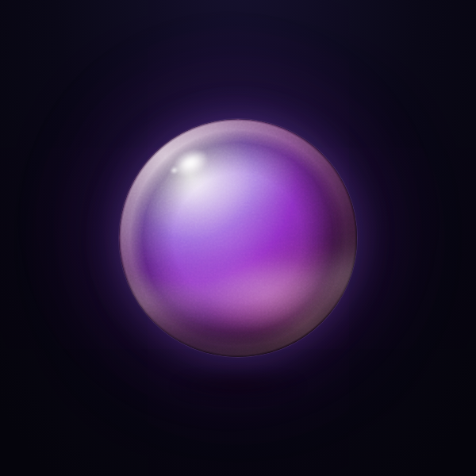
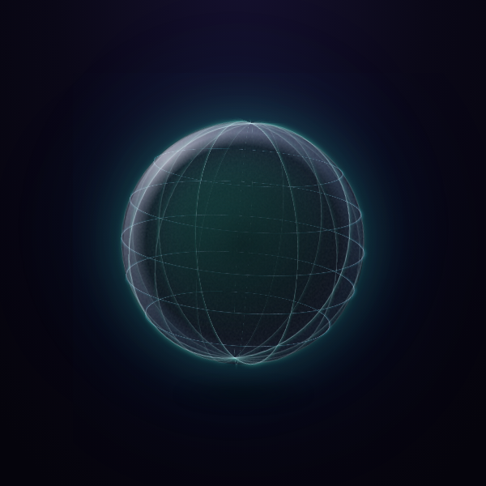
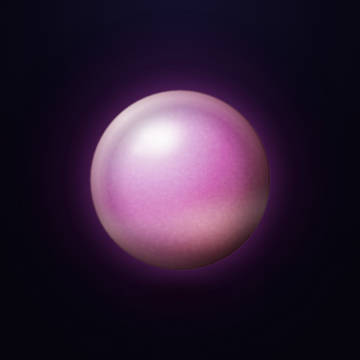
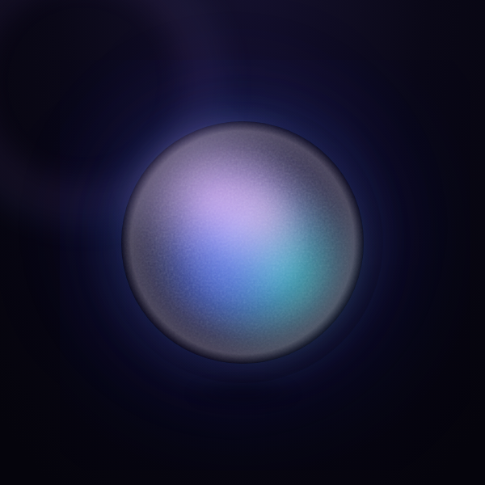
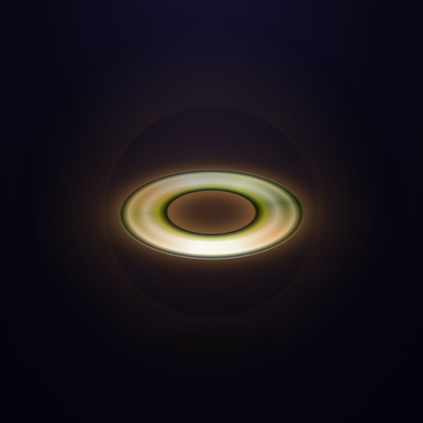
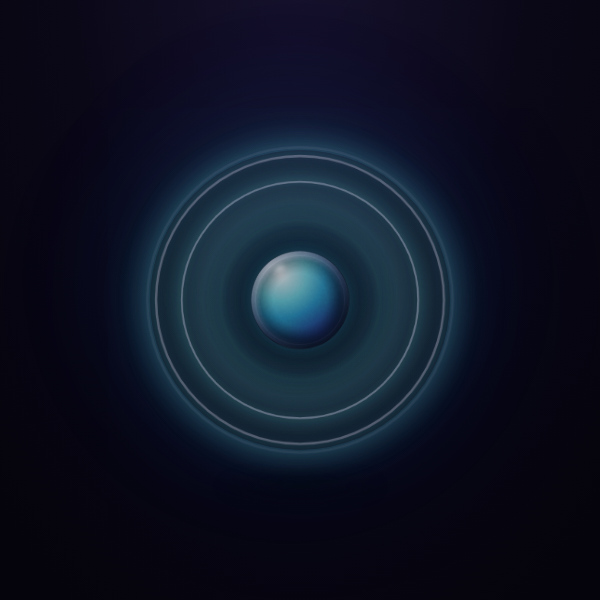
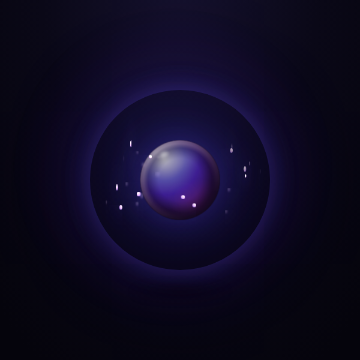
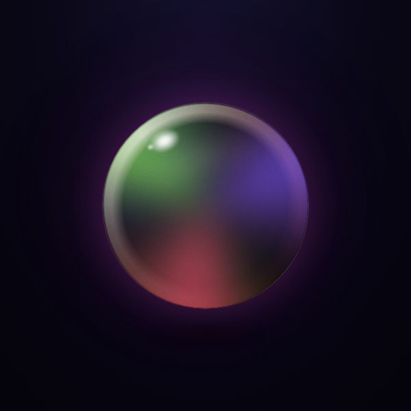

<p align="center">
  
</p>

<h1 align="center">Orbs</h1>

<p align="center">
  <strong>Photoreal CSS orbs for AI assistants.</strong><br>
  Nine materials, four states, zero dependencies, no canvas, no shaders, no images.
</p>

<p align="center">
  <a href="index.html">Gallery</a> ·
  <a href="orbs/orb-3d-sphere.html">Glass sphere</a> ·
  <a href="orbs/orb-3d-gyro.html">Gyro</a> ·
  <a href="orbs/orb-3d-globe.html">Globe</a> ·
  <a href="orbs/orb-grain.html">Grain</a> ·
  <a href="orbs/orb-grain-glow.html">Grain glow</a> ·
  <a href="orbs/orb-3d-torus.html">Torus</a> ·
  <a href="orbs/orb-ripple.html">Ripple</a> ·
  <a href="orbs/orb-3d-particles.html">Dust</a> ·
  <a href="orbs/orb-aurora.html">Aurora</a>
</p>

---

Most "AI orbs" are a radial gradient with a blur on top. They read as a sticker because
nothing in them obeys light. These do: one key light, one bounce light, a fresnel rim that
only shows at grazing angles, a horizon reflection inside the glass, and a contact shadow
that stays on the floor while the orb floats above it.

That is the whole trick, and it is all CSS.

```html
<script src="orb.js"></script>

<assistant-orb variant="sphere" state="listening" size="168" hue="265"></assistant-orb>
```

## Previews

| <br>**Glass Sphere** | <br>**Neon Gyro** | <br>**Wire Globe** |
| :-: | :-: | :-: |
| <br>**Grain** | <br>**Grain Glow** | <br>**Metal Torus** |
| <br>**Sonar Ripple** | <br>**Dust Field** | <br>**Aurora Marble** |

Every image is a real screenshot of the component, captured with `npm run shots`.

## The collection

| Orb | Material | Demo |
| --- | --- | --- |
| **Glass Sphere** | Polished glass. Terminator, caustic, horizon reflection, film grain. | [`orb-3d-sphere.html`](orbs/orb-3d-sphere.html) |
| **Neon Gyro** | Three rings rotating in real 3D around a lit core, drawn twice for depth. | [`orb-3d-gyro.html`](orbs/orb-3d-gyro.html) |
| **Wire Globe** | Real meridians and latitudes in 3D, atmosphere rim, volumetric haze. | [`orb-3d-globe.html`](orbs/orb-3d-globe.html) |
| **Grain** | Sandblasted. Wide specular, two grain layers running at different speeds. | [`orb-grain.html`](orbs/orb-grain.html) |
| **Grain Glow** | No surface at all. Plasma blobs, dust grain, wide halo. | [`orb-grain-glow.html`](orbs/orb-grain-glow.html) |
| **Metal Torus** | One element tilted in 3D. Tube shading plus a conic light wrap. | [`orb-3d-torus.html`](orbs/orb-3d-torus.html) |
| **Sonar Ripple** | Glass bead inside four staggered rings, all driven by the state clock. | [`orb-ripple.html`](orbs/orb-ripple.html) |
| **Dust Field** | Two 3D dust shells around a hot nucleus; the rear shell is dimmed. | [`orb-3d-particles.html`](orbs/orb-3d-particles.html) |
| **Aurora Marble** | Three conic veils inside a dark marble, held in by a dark limb. | [`orb-aurora.html`](orbs/orb-aurora.html) |

Open `index.html` for the gallery, or any `orbs/*.html` file on its own — each one is fully
self-contained and has a state switcher so you can see all four states.

## States

States are not separate animations bolted on. One clock per state re-times the whole orb:

| State | What it does | Use it when |
| --- | --- | --- |
| `idle` | Slow float, long breath, dim bloom | Waiting |
| `listening` | Fast pulse, brighter rim, quicker internal current | Mic is open |
| `thinking` | Internal current spins up hard, bloom tightens | Waiting on a model |
| `speaking` | Uneven surface pops, because speech is not a sine wave | Playing TTS |

```js
const orb = document.querySelector("assistant-orb");

orb.setState("thinking");
orb.addEventListener("orbstatechange", (e) => {
  console.log(e.detail.previous, "->", e.detail.state);
});
```

## Install

Three ways, pick one:

**1. The component** - copy `orb.js` (52 kB, no imports, no network requests) and use the tag:

```html
<script src="orb.js"></script>
<assistant-orb variant="globe" state="thinking" size="160" hue="168"></assistant-orb>
```

It is a classic script, not an ES module, so it also works straight from `file://`.

**2. A single file** — download any `orbs/*.html`, delete the demo chrome, keep the `<style>`
block and the `.orb-stage` markup. Nothing else is needed.

**3. The stylesheet** — `orb.css` plus the markup from `src/markup/<variant>.html`:

```html
<link rel="stylesheet" href="orb.css">

<div class="orb-stage" data-state="thinking" style="--orb-h:265;--orb-size:168px">
  <!-- markup from src/markup/sphere.html -->
</div>
```

Change a state by flipping one attribute. No JS required at all.

## Attributes

| Attribute | Default | Values |
| --- | --- | --- |
| `variant` | `sphere` | `sphere`, `gyro`, `globe`, `grain`, `grain-glow`, `torus`, `ripple`, `particles`, `aurora` |
| `state` | `idle` | `idle`, `listening`, `thinking`, `speaking` |
| `size` | `168` | `24`–`900` (px) |
| `hue` | `265` | `0`–`360` |
| `speed` | `1` | `0.1`–`3`, global time multiplier |
| `label` | `Assistant orb` | accessible name |
| `paused` | — | freeze all animation |
| `decorative` | — | hide from assistive tech |

`paused` is handy for screenshots, tests and pages with a lot of orbs.

## Theming

Hue is the only colour you set. Shadows, bounce light, rim, bloom and grain are all derived
from it with `calc()`, so the light stays consistent no matter what brand colour you use.

| Hue | Reads as |
| --- | --- |
| `265` | Violet (default) |
| `222` | Indigo |
| `196` | Cyan |
| `168` | Mint |
| `140` | Emerald |
| `38` | Amber |
| `350` | Rose |
| `0` | Crimson |

Custom properties on the stage, if you prefer CSS-only theming:

| Property | Used for |
| --- | --- |
| `--orb-h` | base hue, everything else is derived |
| `--orb-size` | diameter; all lighting geometry scales with it |
| `--orb-speed` | global time multiplier |
| `--glow` | bloom strength, set per state |

## Accessibility

- The stage is a labelled `role="img"` and its label includes the current state.
- `decorative` removes it from the accessibility tree entirely.
- All motion is disabled under `prefers-reduced-motion: reduce`, including the grain loop.
- Widgets in the demo pages are real `<button>`s with `aria-pressed` and visible focus rings.

The orb is decoration, not information: never let it be the only signal that the assistant is
listening. Pair it with text or a live region.

## What makes them read as real

- **One key light, everywhere.** Every gradient, shadow and highlight is anchored to a light at
  `33% / 24%`. Break that and the orb instantly looks painted.
- **Fresnel, not a border.** The rim only appears at grazing angles; it is a screen-blended
  radial ring, never a stroked edge.
- **Bounce and contact.** A cool bounce lights the lower right, and a separate soft shadow stays
  on the floor while the orb floats.
- **Grain that moves.** Static noise reads as texture; noise that re-rolls 24 times a second
  reads as film. Two layers at different speeds kill the tiling.
- **Depth rigs.** The gyro is drawn twice — a dimmed, blurred rig behind the core and a sharp one
  in front — so the rings genuinely pass behind it.
- **Real 3D, not fake ellipses.** Meridians are circles rotated on the Y axis inside a
  `preserve-3d` rig, so the projection is always correct.

There are no filters on the interaction path and no per-frame JavaScript. The heaviest orb is a
few dozen DOM nodes and compositor-friendly transforms.

## Browser support

Chrome / Edge 88+, Firefox 103+, Safari 15.4+. Needs `radial-gradient`, CSS `mask` and
`preserve-3d` — all long-supported. `prefers-reduced-motion` degrades to a still image.

**Designed for dark surfaces.** These are lit objects; they need a dark room to glow in.

## Project structure

```
orb.css                 stylesheet — the single source of truth for every orb
orb.js                  <assistant-orb> web component (generated)
orbs/                   standalone demos, one self-contained file per orb (generated)
src/component.js        component source, with placeholders
src/markup/*.html       per-variant markup
scripts/build.mjs       inlines orb.css + src/markup into orbs/ and orb.js
scripts/serve.mjs       tiny zero-dependency static server
scripts/screenshots.mjs renders assets/previews/*.png and the banner with a real browser
assets/preview.html     the README banner source, rendered from the real component
assets/orb-preview.html single-orb screenshot source (?variant=&hue=&size=)
assets/previews/*.png   one 600×600 preview per orb, captured on a dark stage
index.html              the gallery
orbs.json               machine-readable manifest
```

## Development

```bash
npm run build   # regenerate orbs/*.html and orb.js from orb.css + src/
npm run dev     # serve the gallery at http://localhost:4173
npm run shots   # re-render assets/previews/*.png and the README banner
```

Edit `orb.css` or `src/`, never the generated files. The build reads the stylesheet once and
injects it into the demos and the component, so the demos can never drift from the component.

## License

MIT — see [LICENSE](LICENSE).
